# «ДомПрозрачно»: план по неделям

План ведётся **без календарных дат**, по двадцати относительным учебным неделям. Н01 — первый недельный цикл проекта, Н20 — заключительный цикл подготовки к защите. Дни и время работы команда согласует гибко в Telegram. Число недель — плановый горизонт, который уточняется по фактическому темпу работы.

План построен от цели завершить курс, без известных данных о скорости команды. 17 модулей распределены по 16 рабочим неделям: М12–М14 занимают две недели. Это допущение о возможности совмещения, которое требует проверки по расписанию курса. Плюс 4 недели общего резерва: **4 / 16 = 25% от базовой работы** или **4 / 20 = 20% календарного горизонта**. Резерв не скрыт в длительностях задач.

```mermaid
gantt
    title ДомПрозрачно — относительные учебные недели Н01–Н20
    dateFormat X
    axisFormat " "
    tickInterval 1week
    weekday thursday
    todayMarker off

    section R0 Основание — М01–М02
    Н01 · Требования и процесс М01            :r0a, 0, 7d
    Н02 · Репозиторий и проверки М02          :r0b, after r0a, 7d
    R0 требования и правила утверждены       :milestone, r0, after r0b, 0d

    section R1 Каркас — М03–М04
    Н03 · Доступ к счёту и проба провайдера М03 :r1a, after r0b, 7d
    Н04 · Тесты доступа и улучшение среза М04  :r1b, after r1a, 7d
    R1 доступ воспроизводим                  :milestone, r1, after r1b, 0d

    section R2 Проектирование — М05–М08
    Н05 · Требования и NFR начислений М05     :r2a, after r1b, 7d
    Н06 · Моделирование начислений и расходов М06 :r2b, after r2a, 7d
    Н07 · Архитектура и контракт провайдера М07 :r2c, after r2b, 7d
    Н08 · Предметная модель и прототип пути М08 :r2d, after r2c, 7d
    R2 модель и состояния проверены          :milestone, r2, after r2d, 0d

    section R3 MVP — М09–М11
    Н09 · Начисление целиком US03–US05         :r3a, after r2d, 7d
    Н10 · Расходы целиком US06–US07            :r3b, after r3a, 7d
    Н11 · Комиссия и оплата US08–US10          :r3c, after r3b, 7d
    R3 основной путь MVP проходит            :milestone, r3, after r3c, 0d

    section R4 Зрелость — М12–М14
    Н12 · Асинхронный результат и повторы М12 :r4a, after r3c, 7d
    Н13 · Доставка и наблюдаемость М13–М14     :r4b, after r4a, 7d
    R4 результат устойчив к задержкам        :milestone, r4, after r4b, 0d

    section Общий резерв
    Н14–Н17 · Буфер неопределённости 25 процентов :buffer, after r4b, 28d

    section R5 Защита — М15–М17
    Н18 · Завершение веб-клиента М15           :r5a, after buffer, 7d
    Н19 · Аудит и проверка гипотез М16         :r5b, after r5a, 7d
    Н20 · Архитектурный обзор и демонстрация М17 :r5c, after r5b, 7d
    R5 готовность к защите                   :milestone, r5, after r5c, 0d
```

Идентификаторы US03–US10 в подписях Ганта означают истории US-03–US-10 карты; это краткие подписи, не новые истории. Все задачи на диаграмме запланированы: статусы выполненной работы не выставлены. Номера недель указаны в названиях задач; расстояние между вертикальными линиями сетки равно одной неделе. Для работы движка Mermaid используется нулевое служебное начало отсчёта, календарные подписи и отметка текущего дня отключены. Техническое выравнивание сетки не назначает команде день работы.

## Недельная сетка и контрольные точки

Границы периодов задаются номером учебной недели, а не календарными сроками.

| Недели | Веха / модули | Проверяемый результат | Зависимость |
|---|---|---|---|
| 1–2 | R0 / М01–М02 | Утверждены домен и состав команды; есть карты, Must, процесс; в М02 доступны репозиторий и проверки | Начало курса |
| 3–4 | R1 / М03–М04 | US-01/US-02 проходят на чистом окружении; проверен внешний тестовый доступ, чужие данные недоступны | R0 |
| 5–8 | R2 / М05–М08 | Согласованы контексты, состояния, NFR, прототип и контракт тестового платежа | R1 и сведения о провайдере |
| 9 | R3 / М09–М11 | Бухгалтер публикует начисление, житель читает его состав; срез включает хранение, контракт, интерфейс и проверки | R2; US-01/US-02 |
| 10 | R3 / М09–М11 | Представитель публикует расходы, житель читает категории; срез включает хранение, контракт, интерфейс и проверки | Неделя 9 и модель R2 |
| 11 | R3 / М09–М11 | US-08–US-10 и полный путь US-01–US-10 проходят; отказ и ожидание не дают ложного успеха | Недели 9–10 и внешний тестовый контур |
| 12–13 | R4 / М12–М14 | Проверены повторы, задержки и восстановление сверки; доставка и наблюдаемость воспроизводимы | R3 |
| 14–17 | Общий резерв | Закрываются выявленные риски Must; расход резерва записывается, новые обещания не добавляются | Доступен для отклонений любой вехи |
| 18–20 | R5 / М15–М17 | Клиент завершён; есть аудит, результаты проверки гипотез, архитектурный обзор и демонстрация | R4 и закрытие критических рисков |

## Управление буфером

Резерв показан одним блоком перед заключительной поставкой, но может быть перенесён к более ранней вехе при возникновении риска; общий размер от этого не увеличивается. При переносе пересчитываются зависимости и номера недель, а запись в CHANGELOG содержит причину, потраченное время, оставшийся запас и новый прогноз.

Если отставание равно двум неделям, остаются ещё две недели резерва. v1.1/v1.2 не используются как скрытый обязательный объём. Если резерв исчерпан, команда обсуждает новый прогноз и согласует изменение сроков/объёма с преподавателем. Нельзя объявить проверку внешней интеграции выполненной на основании эмулятора.

Опекин Егор отслеживает недельный план и расход буфера. По результатам первых двух циклов команда проверяет, помещаются ли М12–М14 в две недели, и при необходимости пересчитывает общий горизонт. Рабочие дни внутри недель не фиксируются: фактическая доступность участников учитывается при планировании каждого цикла.
