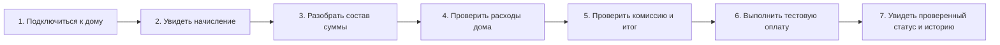

# «ДомПрозрачно»: требования и границы проекта

Лабораторные работы №1 «Запуск сквозного проекта команды» и №2 «Проектирование системы». Это спецификация учебного проекта; разработка приложения ещё не выполнялась. Тема «ДомПрозрачно» одобрена преподавателем. Команда: Белянский Глеб, Опекин Егор и Рогачев Егор. Проект планируется по учебным неделям без календарных дат.

## 1. Предметная область и выбор домена

«ДомПрозрачно» — веб-платформа для жильцов многоквартирного дома, представителя УК/ТСЖ и бухгалтера. Она связывает начисления конкретного лицевого счёта, тестовые платежи и опубликованные расходы дома. Житель получает объяснение суммы и расходов, а управляющая организация публикует исходные сведения в одном месте.

Рассмотрены три кандидата. Это аналитическое сравнение, а не отчёт о состоявшемся обсуждении команды.

### Кандидат 1. Платформа УК/ТСЖ «ДомПрозрачно» — выбран

| Требование | Проверка | Итог |
|---|---|---|
| Не менее 2–3 ограниченных контекстов | Доступ к дому и лицевым счетам; начисления и платежи; отчётность о расходах. В будущем — обращения и жизнь дома | Проходит: три контекста уже в MVP |
| Внешняя интеграция | Тестовый контур внешнего платёжного провайдера: создание платежа и получение проверенного статуса | Проходит как требование; доступность проверяется в М03 |
| Осмысленный интерфейс | Кабинет жителя с начислением, расшифровкой, расходами, тестовой оплатой и историей; рабочее место УК/ТСЖ и бухгалтера | Проходит |
| Нетривиальные данные | Организация → дом → лицевые счета → начисления → строки; платёжные попытки и события статусов; отчёты → категории расходов; права доступа | Проходит: связи, состояния и история |

### Кандидат 2. Сервис записи в ремонтную мастерскую

| Требование | Проверка | Итог |
|---|---|---|
| Не менее 2–3 контекстов | Клиенты и устройства; заказы и ремонт; расчёты | Проходит |
| Внешняя интеграция | Внешняя отправка уведомлений о готовности | Проходит как возможное направление |
| Осмысленный интерфейс | Заявка клиента, состояние ремонта, рабочее место мастера | Проходит |
| Нетривиальные данные | Устройство, заказ, работы, запчасти, изменения статуса | Проходит |

Домен возможен, но не проверяет заданную пользователем гипотезу прозрачности содержания дома.

### Кандидат 3. Простая доска объявлений подъезда

| Требование | Проверка | Итог |
|---|---|---|
| Не менее 2–3 контекстов | Публикация объявлений — один основной контекст | Не проходит в этой формулировке |
| Внешняя интеграция | Не предусмотрена | Не проходит |
| Осмысленный интерфейс | Лента и создание объявления | Проходит |
| Нетривиальные данные | Объявление и автор; предметных состояний и истории почти нет | Недостаточно |

Выбран домен УК/ТСЖ: он соответствует всем четырём требованиям и позволяет проверить важную ценность на одном доме без охвата всего ЖКХ. Границы контекстов предварительные, уточняются в М05–М08; окончательный стек здесь не выбирается.

## 2. Постановка проблемы

**Что:** сведения о начислениях, оплате и расходах дома разнесены между квитанциями, таблицами и перепиской. Житель не может быстро объяснить начисленную сумму и понять опубликованные расходы; УК/ТСЖ и бухгалтер повторно отвечают на одни и те же вопросы и вручную сверяют сведения.

**Для кого:** жильцы одного пилотного многоквартирного дома, сотрудник его управляющей организации/председатель ТСЖ и бухгалтер, обслуживающий этот дом. Для учебной демонстрации используются вымышленные данные без реальных лицевых счетов и документов жильцов.

**Зачем:** дать жителю понятную цепочку «начислено → из чего состоит → какие расходы опубликованы → каков результат оплаты», а организации — единый способ публикации этих сведений. Публикация отчёта сама по себе не доказывает обоснованность расходов.

**Как измерим успех:** при проверке MVP зафиксируем два показателя. Первый — доля участников, которые без подсказок проходят семишаговый сценарий жителя: число завершивших сценарий делится на число начавших. Второй — медианное время проверки начисления: от открытия опубликованного документа до правильного ответа о периоде, итоговой сумме и составе строк. В отчёте укажем число участников; целевые пороги зададим после базового замера, а до проверки не будем выдавать гипотезы за результаты.

## 3. Персоны

Персоны — поведенческие гипотезы на основе задания. Их необходимо уточнить интервью; реальные ФИО и контакты не используются.

### P1. Житель многоквартирного дома

**Контекст:** раз в месяц с телефона проверяет квитанцию своего лицевого счёта, хочет понять сумму до оплаты.

**Цели:** проверить начисления, увидеть расходы дома, оплатить без скрытой комиссии и убедиться в результате.

**Сейчас:** бумажная квитанция, банковское приложение, объявления и переписка с УК/ТСЖ.

**Боли:** непонятные строки; расходы не связаны с периодом; после нажатия «Оплатить» непонятен статус; приходится повторять вопросы разным сотрудникам.

**Ожидания:** видимые дом и счёт, расшифровка, отчёт с периодом, комиссия до подтверждения, достоверная история. Отсюда US-02, US-04, US-05, US-07–US-10; обращения и показания отложены.

### P2. Представитель УК/председатель ТСЖ

**Контекст:** ведёт сведения по дому, публикует отчёт, отвечает жильцам при ограниченном времени.

**Цели:** открыть доступ нужным жильцам и объяснять расходы единой публикацией.

**Сейчас:** таблица лицевых счетов, отчёт в файле, ответы в нескольких чатах.

**Боли:** ошибочные привязки, разные версии отчёта, недоверие к общим суммам, повторяющиеся вопросы.

**Ожидания:** доступ только к своему дому, проверка приглашений, публикация согласованного отчёта по категориям. Отсюда US-01 и US-06; документы, ответы и объявления — последующие релизы.

### P3. Бухгалтер/специалист по расчётам

**Контекст:** ежемесячно готовит начисления и сверяет результат оплаты. Не заменяет представителя УК/ТСЖ в управлении доступом.

**Цели:** опубликовать однозначные строки начисления, избежать дублей и ложных отметок об оплате.

**Сейчас:** расчётная таблица, отдельная выгрузка банка, ручное сопоставление по счёту и периоду.

**Боли:** расхождение сумм, повторная публикация, платёж без понятного идентификатора.

**Ожидания:** контроль итогов и периода, стабильные идентификаторы и проверенные статусы. Отсюда US-03 и требования к US-09–US-10; отдельная бухгалтерская сводка US-18 отложена в v1.1.

## 4. Путь жителя: семь шагов

Предусловия: представитель подготовил дом, счёт и приглашение (US-01), бухгалтер опубликовал начисление (US-03), представитель опубликовал расходы (US-06). В MVP поддерживается один пилотный дом и один подтверждённый лицевой счёт на жителя.

1. **Подключиться к дому** — войти под учебной учётной записью, погасить одноразовое приглашение и увидеть свой дом/счёт (US-02). По одному знанию номера квартиры доступ не выдаётся.
2. **Увидеть начисление** — выбрать опубликованный период и увидеть сумму к оплате по своему счёту (US-04).
3. **Разобрать состав суммы** — проверить услуги, основание суммы и итог строк (US-05).
4. **Проверить расходы дома** — выбрать период отчёта и увидеть категории и общую сумму (US-07). Расходы дома и начисление квартиры различаются по смыслу и не обязаны совпадать.
5. **Проверить комиссию и итог** — увидеть отдельные суммы начисления, комиссии и списания, затем подтвердить согласие (US-08).
6. **Выполнить тестовую оплату** — перейти в тестовый контур провайдера с явной пометкой о тесте (US-09).
7. **Увидеть проверенный статус и историю** — дождаться подтверждения либо увидеть ожидание/отказ; возврат из формы провайдера не означает успех (US-10).

Отказы и отсутствие данных описаны в [критериях приёмки](user-story-map.md). Путь не требует показаний, чатов или голосований.

## 5. MVP: точный состав

Обязательный набор — **US-01–US-10**, и только он имеет приоритет Must. Все истории и критерии находятся в [User Story Map](user-story-map.md); схема — [редактируемый файл](user-story-map.drawio), просмотр — [экспорт PNG](user-story-map.png).

| Истории | Возможность | Почему нужна в первом релизе |
|---|---|---|
| US-01, US-02 | Подготовить доступ к одному дому/счёту и подтвердить привязку жителя | Без этого сведения не относятся к конкретному пользователю |
| US-03, US-04, US-05 | Опубликовать, увидеть и расшифровать начисление | Даёт понятную сумму для оплаты |
| US-06, US-07 | Опубликовать расходы и просмотреть категории за период | Проверяет основную ценность прозрачности |
| US-08 | Показать комиссию и итог до согласия | Исключает скрытое списание и проверяет гипотезу монетизации |
| US-09 | Создать тестовый платёж через внешний тестовый контур | Проверяет интеграцию, не требует реальных денег |
| US-10 | Показать проверенный статус и историю попыток | Завершает сценарий и предупреждает повторную оплату |

Для учебного объёма: один дом, одна организация, один счёт на жителя, один вид валюты — рубли, ручной ввод подготовленных начислений и отчётов уполномоченными сотрудниками. Начисления не рассчитываются платформой по нормативам; она публикует подготовленные данные. В MVP оплачивается полная неоплаченная сумма одного начисления одной операцией. Частичная оплата, перерасчёты и автоматическое перенесение долга не поддерживаются.

## 6. Сквозные требования и предметные правила

| ID | Требование | Проверка / связанные истории |
|---|---|---|
| FR-01 | Сведения лицевого счёта доступны только привязанному жителю; сотрудник действует только в своей организации/доме | Попытка открыть чужой счёт отклоняется, US-01–US-05, US-10 |
| FR-02 | Начисление содержит счёт, период, строки и итог; сумма строк равна итогу; после публикации исходная сумма не меняется | US-03–US-05; корректировки отложены |
| FR-03 | Отчёт содержит дом, период, автора, дату публикации, категории и сумму; отсутствие отчёта явно отличается от нулевых расходов | US-06, US-07 |
| FR-04 | До оплаты раздельно показаны сумма начисления, ставка и сумма комиссии, итог и получатель; изменение условий требует нового согласия | US-08, US-09 |
| FR-05 | Только подтверждённое внешним провайдером событие или проверка его API меняет платёж на «Успешен»; повторы событий не удваивают результат | US-09, US-10 |
| FR-06 | История сохраняет идентификатор попытки, начисление, суммы, дату и состояние; житель видит только свои попытки | US-10 |

Учётная запись, роль и принадлежность к организации задаются в учебном контуре заранее; вход обязателен. Полный сервис регистрации и восстановления доступа не входит в MVP. Приглашение одноразовое, ограничено сроком, привязано к дому и счёту; правило проверки права выдачи формулируется для пилота до разработки.

Основные сущности и состояния (без проектирования базы данных):

- Дом принадлежит организации; лицевой счёт относится к дому; подтверждённая привязка соединяет жителя и счёт. Приглашение: «Выдано → Использовано» либо «Истекло».
- Начисление содержит строки и проходит «Черновик → Опубликовано». Факт успешного платежа отражается отдельно; исходный документ не перезаписывается.
- Отчёт о расходах: «Черновик → Опубликован», категории суммируются за явно указанный период. Правка опубликованного отчёта с версиями отложена.
- Платёжная попытка: «Создана → Ожидает → Успешна / Отклонена». Ошибка связи оставляет неопределённый результат в «Ожидает» с пояснением и последующей сверкой; она не доказывает отказ. Итоговые состояния не откатываются поздним событием ожидания.
- Повтор запроса с тем же ключом возвращает ту же попытку; новая попытка разрешена после подтверждённого отказа. Пока исход не выяснен, повторное списание блокируется. Повторный успех для уже оплаченного начисления исключается.

Расходы показываются по дому, начисления и оплаты — по лицевому счёту. Платформа не утверждает, что конкретный рубль конкретного жителя направлен на определённую работу. Публикуемые сведения — данные УК/ТСЖ, не независимый аудит и не сведения из государственных систем.

## 7. Монетизация — гипотеза

Гипотеза: платформа получает процент от успешно проведённых платежей. Размер ставки, сторона, оплачивающая комиссию, отношения с провайдером и экономическая жизнеспособность ещё не подтверждены.

Для проверки интерфейса принимается **учебное допущение**: комиссию оплачивает житель сверх начисления; начисление получает свою полную сумму. В тестовом примере A = 3 000 ₽, демонстрационная ставка p = 1%, комиссия C = 30 ₽, итог T = 3 030 ₽. **1% — только тестовые данные**, не тариф и не договорённость. C округляется до копеек по правилу «половина вверх», T = A + C. Все денежные значения сравниваются в копейках; ставка и суммы фиксируются в предложении перед оплатой.

Строки «Начисление», «Комиссия платформы», «Итого к списанию» видны до ухода к провайдеру и затем в истории. Любые дополнительные удержания провайдера должны входить в показанный итог; скрытое удержание недопустимо. При изменении предложения требуется повторное согласие. В доход не засчитываются ожидающие и отклонённые платежи; учебные успехи не создают реальной выручки.

Проверить предстоит готовность пользователей платить, модель плательщика комиссии, доступность тестового контура, ограничения провайдера и будущие условия работы с деньгами. Реальные договоры и правовые выводы здесь не делаются.

## 8. Следующие релизы и границы

v1.1 — US-11–US-18: подтверждающие документы, выгрузка отчёта, показания, обращения с ответами, уведомления, сводка платежей для бухгалтера. v1.2 — US-19–US-24: несколько счетов, аналитика, чат с модерацией, консультативные голосования. Это направления после MVP, а не обязательство реализовать их до защиты. R4 и R5 развивают качество MVP, а не автоматически включают v1.1/v1.2.

| Что не делаем | Горизонт | Почему |
|---|---|---|
| Показания, обращения, уведомления, документы и бухгалтерская сводка | Вне MVP; v1.1 | Полезны, но не требуются для проверки прозрачности и тестовой оплаты |
| Чаты, модерация, аналитика, несколько счетов, консультативные голосования | Вне MVP; v1.2 | Отдельные сценарии и нагрузка на поддержку |
| Реальный процессинг, банковские договоры, реальные выплаты и фискальные документы | Вне семестра; Won't | Учебный тестовый контур не подтверждает готовность работы с деньгами |
| Юридически значимое общее собрание собственников | Вне семестра; Won't | Консультативный опрос не заменяет юридическую процедуру |
| Интеграция с ГИС ЖКХ и другими государственными системами | Вне семестра; Won't | Нет подтверждённых доступов и контрактов, не нужна основной гипотезе |
| Автоматический расчёт тарифов, перерасчёты, частичные оплаты, возвраты | Вне семестра; Won't | Значительно расширяет финансовую модель; MVP публикует готовые начисления |
| Нативные приложения и перенос реальных баз жильцов | Вне семестра; Won't | Веб-сценария и синтетических данных достаточно для учебной проверки |

## 9. Организация проверки и подготовка к защите

Участники, контакты и ответственность записаны в [process.md](process.md); тема одобрена преподавателем. Команда выбрала гибкий график, Telegram и GitHub Projects. [План](gantt.md) рассчитан на двадцать относительных учебных недель без календарных дат. Один учебный дом, тестовые платежи, десять историй MVP, состав v1.1/v1.2 и демонстрационная комиссия 1% подтверждены как рамки проекта.

В М03 Опекин Егор проверяет доступность внешнего тестового провайдера. Если доступ не получен, эмулятор допустим только как временное средство разработки; требование внешней интеграции остаётся незакрытым и изменение объёма согласуется явно. Поставщик будет выбран по доступности тестового контура и требованиям к подтверждению результата; окончательный стек в лабораторной №1 не выбирается.

По сообщению команды обсуждений с жильцами/УК/ТСЖ, ревью другим участником и репетиции защиты пока не было. До сдачи Рогачев Егор организует проверку документов, затем команда репетирует рассказ. Способ измерения успеха указан в разделе 2; фактические измерения ещё не проводились, персоны и продуктовые цели остаются гипотезами.

Тезисы трёхминутного рассказа: делаем прозрачные начисления и расходы для одного дома; житель проходит семь шагов, УК/ТСЖ и бухгалтер готовят сведения; Must — ровно US-01–US-10; дополнительные каналы общения и реальные деньги отложены; поставляем сценариями по R0–R5 с общим буфером 25% от базовой работы. Устная репетиция и проверка независимым однокурсником ещё не проводились.

## 10. ЛР 2А: источники, ограничения и приоритеты

Проектная спецификация от 2026-11-07. Числа ниже — целевые гипотезы, а не результаты измерений. Идентификаторы FR-01–FR-06 из ЛР 1 сохранены. Все десять историй MVP остаются Must.

| Сторона | Интерес | Требования |
|---|---|---|
| Житель P1 | Понятная сумма и свой счёт | FR-01–FR-06, NFR-01, NFR-04 |
| Представитель P2 | Доступ и расходы дома | FR-01, FR-03 |
| Бухгалтер P3 | Неизменные суммы и достоверный платёж | FR-02, FR-04–FR-06, NFR-02 |
| Заказчик пилота | Самостоятельный путь жителя | BR-01, BR-02 |
| Эксплуатация | Диагностика и восстановление | NFR-03, NFR-05 |
| Разработка | Изолированные правила | NFR-06 |
| Преподаватель | Воспроизводимые артефакты | NFR-07 |

| ID | Ограничение | Источник и что сужает |
|---|---|---|
| C-01 | Три человека, один семестр | Курс; исключает независимую эксплуатацию множества сервисов |
| C-02 | Один дом, один счёт на жителя, RUB | Рамки ЛР 1; исключает мультиарендность пилота и конверсию |
| C-03 | Только браузер и синтетические данные | ЛР 1; исключает нативные клиенты и реальные базы |
| C-04 | Python + FastAPI для backend | Методичка, ADR-0002; ограничивает выбор серверного стека |
| C-05 | Только внешний тестовый платёжный контур | ЛР 1; исключает реальные списания, провайдер ещё не выбран |
| C-06 | Нет частичных оплат и перерасчётов | ЛР 1; разрешена полная оплата одного начисления |

### Бизнес-цели

| ID | Цель и исходное значение | Как проверить | Приоритет |
|---|---|---|---|
| BR-01 | Не менее 4 из 5 участников самостоятельно завершают семь шагов; исходное значение неизвестно | До MVP провести базовый замер на текущих материалах; затем 5 синтетических заданий без подсказок | Should |
| BR-02 | Медиана времени объяснения начисления ≤120 с и ниже базовой; исходная медиана неизвестна | Засечь период, итог и состав до и после; если база быстрее 120 с, цель уточнить | Should |

Нельзя подменять неизвестную базу выдуманным числом. Эти цели нуждаются в базовом замере до подтверждения заказчиком.

### Функциональные истории и проверка INVEST

| ID | История и источник | US из ЛР 1 | INVEST |
|---|---|---|---|
| FR-01 | Как житель, хочу подтвердить доступ только к своему счёту, чтобы сохранить конфиденциальность; P1/P2 | US-01, US-02 | I: отдельный сценарий доступа; N: форма приглашения обсуждаема; V: приватность; E/S: один дом; T: AC-01 |
| FR-02 | Как бухгалтер, хочу публиковать неизменяемый состав начисления, чтобы житель проверил итог; P3/P1 | US-03–US-05 | I: публикация отдельно от оплаты; N: ввод обсуждаем; V: объяснимость; E/S: один период; T: AC-02 |
| FR-03 | Как представитель, хочу публиковать расходы дома по категориям, чтобы житель видел их структуру; P2/P1 | US-06, US-07 | I: независимо от начисления; N: категории обсуждаемы; V: прозрачность; E/S: один отчёт; T: AC-03 |
| FR-04 | Как житель, хочу заранее согласовать полную сумму, чтобы комиссия была известна; P1 | US-08 | I: отдельное согласование; N: представление обсуждаемо; V: нет скрытой суммы; E/S: один расчёт; T: AC-04 |
| FR-05 | Как житель, хочу выполнить тестовую оплату с проверенным результатом, чтобы не заплатить повторно; P1/P3 | US-09 | I: адаптер провайдера; N: провайдер обсуждаем; V: достоверность; E/S: одна операция; T: AC-05 |
| FR-06 | Как житель, хочу видеть историю своих попыток, чтобы проверить результат; P1/P3 | US-10 | I: чтение истории отдельно; N: порядок обсуждаем; V: сверка; E/S: свой счёт; T: AC-06 |

I означает самостоятельную проверяемую ценность, а не отсутствие зависимостей: FR-04–FR-06 используют опубликованное начисление FR-02.

### Критерии приёмки

Каждая строка задаёт отдельный будущий тест. Период — календарный месяц YYYY-MM; деньги — целые копейки, сумма положительна, максимум 100 000 000 копеек на начисление. Приглашение действительно 24 часа по серверному UTC, момент expires_at уже недействителен.

#### FR-01

- **AC-01.1**. Дано действующее приглашение и вошедший житель; когда он принимает его; тогда появляется ровно одна привязка к указанному счёту.
- **AC-01.2**. Дано уже использованное приглашение; когда его принимает другой житель; тогда конфликт, новая привязка не появляется.
- **AC-01.3**. Дано now = expires_at; когда принимают приглашение; тогда отказ, при now < expires_at при прочих условиях приём разрешён.
- **AC-01.4**. Дано пустое или неизвестное приглашение; когда его принимают; тогда ошибка без сведений о счёте. Дано чужое account_id; когда житель читает его; тогда 404.

#### FR-02

- **AC-02.1**. Дано черновое начисление со строками 10000 и 20000 коп.; когда бухгалтер публикует его; тогда итог 30000, житель видит строки и период.
- **AC-02.2**. Дано опубликованное начисление счёта за месяц; когда публикуют второе; тогда конфликт; изменение исходных строк также отклоняется.
- **AC-02.3**. Дано начисление на 1 или 100000000 коп.; когда его публикуют; тогда сумма допустима; 0 и 100000001 отклоняются.
- **AC-02.4**. Дано период 2026-13 или итог, не равный сумме строк; когда публикуют; тогда ошибка, публикации нет.

#### FR-03

- **AC-03.1**. Дано категории 10000 и 5000 коп.; когда представитель публикует отчёт; тогда житель дома видит период, автора, дату и итог 15000.
- **AC-03.2**. Дано опубликованный отчёт месяца; когда публикуют другой за тот же дом и месяц; тогда конфликт.
- **AC-03.3**. Дано отчёт с нулевым итогом; когда житель читает период; тогда видит ноль, а при отсутствии публикации — отсутствие отчёта.
- **AC-03.4**. Дано отрицательная категория или неизвестный месяц; когда публикуют; тогда ошибка без сохранения публикации.

#### FR-04

- **AC-04.1**. Дано начисление 10000 коп. и ставка 1%; когда рассчитывают предложение; тогда видны 10000, 100, 10100 коп. и получатель.
- **AC-04.2**. Дано истекшее предложение или изменившиеся условия; когда создают платёж; тогда конфликт и требуется новое согласие.
- **AC-04.3**. Дано 1 коп. при 1%; когда считают комиссию; тогда округление half-up до копейки даёт 0 коп.; срок предложения 10 мин., на expires_at оно недействительно.
- **AC-04.4**. Дано неизвестное начисление или подставленная сумма; когда подтверждают оплату; тогда 404 либо 422, клиентская сумма не принимается.

#### FR-05

- **AC-05.1**. Дано согласованное предложение; когда провайдер подтверждает сумму, валюту и идентификатор; тогда попытка успешна и начисление оплачено один раз.
- **AC-05.2**. Дано повтор события или параллельный запрос; когда они обрабатываются; тогда один платёжный эффект; тот же ключ и другое тело дают конфликт.
- **AC-05.3**. Дано тайм-аут создания платежа; когда истекает ожидание; тогда статус остаётся ожидающим, новая попытка блокируется до сверки; возврат браузера не подтверждает успех.
- **AC-05.4**. Дано неверная подпись, сумма или валюта события; когда оно поступает; тогда успех не фиксируется; позднее ожидание не меняет итоговый статус.

#### FR-06

- **AC-06.1**. Дано две попытки своего счёта; когда житель читает историю; тогда видит идентификаторы, начисления, суммы, даты и состояния по created_at и id убыванию.
- **AC-06.2**. Дано попытка чужого счёта; когда житель запрашивает её по id; тогда 404 без финансовых полей.
- **AC-06.3**. Дано limit 1 либо 100; когда читают историю; тогда возвращается не более limit; 0 и 101 дают 422; пустая история даёт пустой список.
- **AC-06.4**. Дано некорректный cursor; когда читают следующую страницу; тогда 422; при подтверждённом отказе новая попытка допустима, старая остаётся в истории.

### Измеримые атрибуты качества

Среда для будущих замеров: Linux, 2 CPU, 4 ГБ RAM, PostgreSQL локально, 100 счетов, 1200 начислений и 10000 попыток. Ответы внешнего провайдера измеряются отдельно.

| ID | Условие и целевой показатель | Обоснование и проверка | Приоритет |
|---|---|---|---|
| NFR-01 | p95 чтения начислений и отчётов ≤500 мс при 20 запросах/с в течение 5 мин. после прогрева 1 мин. | Телефонный сценарий; нагрузочный прогон, HTTP от входа API до ответа | Should |
| NFR-02 | 0 повторных эффектов оплаты на 100 параллельных повторах одного ключа и 100 дублях события | Исключение двойного учёта; конкурентная интеграционная проверка БД | Must |
| NFR-03 | RPO ≤24 ч., RTO ≤30 мин. на учебном стенде | Допустима потеря синтетического дня; восстановить суточный dump и замерить время | Should |
| NFR-04 | 0 успешных чтений чужого счёта в матрице из 3 ролей и 2 домов | Изоляция данных; отрицательные тесты каждой операции, включая подмену id | Must |
| NFR-05 | 100% изменений платежей имеют correlation_id; 0 паролей, токенов и полных приглашений в журнале в 100 сценариях | Диагностика без раскрытия доступа; анализ структурированных журналов | Should |
| NFR-06 | 0 импортов FastAPI, SQLAlchemy и адаптеров инфраструктуры в domain | Возможность менять инфраструктуру; AST-проверка импортов с ЛР 3Б | Should |
| NFR-07 | 100% ADR и Mermaid проходят локальную и CI-проверку; ошибка в обязательном разделе или синтаксисе блокирует проверку | Воспроизводимость сдачи; checker и mermaid-cli | Must |

### MoSCoW и конфликты

Must: FR-01–FR-06, NFR-02, NFR-04, NFR-07 — 9 из 16 требований BR/FR/NFR, то есть 56,25%. Should: BR-01, BR-02, NFR-01, NFR-03, NFR-05, NFR-06 — без них теряем доказательство ценности, заданную скорость, восстановление, диагностику и контроль слоёв. Could: NFR-08 — загрузка истории 100000 попыток с p95 ≤1 с при 5 запросах/с на той же среде; нужна для роста, за пределами пилота. Источник NFR-08 — эксплуатация, проверка нагрузкой. Требования NFR-01–NFR-08, FR и BR образуют знаменатель 16.

Приоритеты 24 историй из карты ЛР 1 сохраняются отдельно: US-01–US-10 Must (41,7%); US-11–US-18 Should, US-19–US-24 Could. Won’t — реальные деньги, ГИС ЖКХ, перерасчёты и нативные клиенты из раздела 8: нет доступа или выход за рамки семестра. Ограничения не включаются в долю Must.

Конфликт 1: скорость NFR-01 против актуальности FR-05. Решение ADR-0005: финансовые статусы читать из основной БД без кеша; сначала индексы и пагинация, цена — нагрузка на БД.

Конфликт 2: удобный повтор оплаты против NFR-02. Решение ADR-0005: блокировать новую попытку при неопределённом исходе и сверять с провайдером; цена — житель временно ждёт.

### Предположения и обратная проверка

| Предположение | Ущерб при ошибке | Как проверить | Состояние |
|---|---|---|---|
| Внешний sandbox доступен и поддерживает идемпотентность и сверку по merchant id | Невозможно безопасно повторить запрос после тайм-аута | Опекин: получить тестовый доступ и проверить создание/повтор/сверку до ЛР 4 | Не проверено |
| Жителю достаточно одного счёта | Не охвачен реальный пользовательский путь | Белянский: 3 интервью по синтетическому сценарию | Не проверено |
| Публикуемые категории понятны без документов | Ценность прозрачности не достигается | Рогачев: 5 заданий на объяснение отчёта | Не проверено |

Обратный проход семи шагов: подключение → FR-01; начисление и состав → FR-02; расходы → FR-03; комиссия → FR-04; оплата → FR-05; история → FR-06. Обеспечивающие US-01/03/06 также покрыты. Пропусков пути не найдено; внешняя интеграция и бизнес-цели пока не подтверждены.

Матрица и проектные решения: [traceability.md](traceability.md). Изменение начинается с требования и AC, затем обновляются агрегат, ADR, диаграммы, ресурсы и матрица в одной локальной правке; код и фактические тесты добавятся с ЛР 3.
