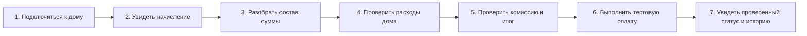

# «ДомПрозрачно»: требования и границы проекта

Лабораторная работа №1 «Запуск сквозного проекта команды». Это спецификация учебного проекта; разработка приложения ещё не выполнялась. Тема «ДомПрозрачно» одобрена преподавателем. Команда: Белянский Глеб, Опекин Егор и Рогачев Егор. Проект планируется по учебным неделям без календарных дат.

## 1. Предметная область и выбор домена

«ДомПрозрачно» — веб-платформа для жильцов многоквартирного дома, представителя УК/ТСЖ и бухгалтера. Она связывает начисления конкретного лицевого счёта, тестовые платежи и опубликованные расходы дома. Житель получает объяснение суммы и расходов, а управляющая организация публикует исходные сведения в одном месте.

Рассмотрены три кандидата. Это аналитическое сравнение, а не отчёт о состоявшемся обсуждении команды.

### Кандидат 1. Платформа УК/ТСЖ «ДомПрозрачно» — выбран

| Требование | Проверка | Итог |
|---|---|---|
| Не менее 2–3 ограниченных контекстов | Доступ к дому и лицевым счетам; начисления и платежи; отчётность о расходах. В будущем — обращения и жизнь дома | Проходит: три контекста уже в MVP |
| Внешняя интеграция | Тестовый контур внешнего платёжного провайдера: создание платежа и получение проверенного статуса | Проходит как требование; доступность проверяется в М03 |
| Осмысленный интерфейс | Кабинет жителя с начислением, расшифровкой, расходами, тестовой оплатой и историей; рабочее место УК/ТСЖ и бухгалтера | Проходит |
| Нетривиальные данные | Организация → дом → лицевые счета → начисления → строки; платёжные попытки и события статусов; отчёты → категории расходов; права доступа | Проходит: связи, состояния и история |

### Кандидат 2. Сервис записи в ремонтную мастерскую

| Требование | Проверка | Итог |
|---|---|---|
| Не менее 2–3 контекстов | Клиенты и устройства; заказы и ремонт; расчёты | Проходит |
| Внешняя интеграция | Внешняя отправка уведомлений о готовности | Проходит как возможное направление |
| Осмысленный интерфейс | Заявка клиента, состояние ремонта, рабочее место мастера | Проходит |
| Нетривиальные данные | Устройство, заказ, работы, запчасти, изменения статуса | Проходит |

Домен возможен, но не проверяет заданную пользователем гипотезу прозрачности содержания дома.

### Кандидат 3. Простая доска объявлений подъезда

| Требование | Проверка | Итог |
|---|---|---|
| Не менее 2–3 контекстов | Публикация объявлений — один основной контекст | Не проходит в этой формулировке |
| Внешняя интеграция | Не предусмотрена | Не проходит |
| Осмысленный интерфейс | Лента и создание объявления | Проходит |
| Нетривиальные данные | Объявление и автор; предметных состояний и истории почти нет | Недостаточно |

Выбран домен УК/ТСЖ: он соответствует всем четырём требованиям и позволяет проверить важную ценность на одном доме без охвата всего ЖКХ. Границы контекстов предварительные, уточняются в М05–М08; окончательный стек здесь не выбирается.

## 2. Постановка проблемы

**Что:** сведения о начислениях, оплате и расходах дома разнесены между квитанциями, таблицами и перепиской. Житель не может быстро объяснить начисленную сумму и понять опубликованные расходы; УК/ТСЖ и бухгалтер повторно отвечают на одни и те же вопросы и вручную сверяют сведения.

**Для кого:** жильцы одного пилотного многоквартирного дома, сотрудник его управляющей организации/председатель ТСЖ и бухгалтер, обслуживающий этот дом. Для учебной демонстрации используются вымышленные данные без реальных лицевых счетов и документов жильцов.

**Зачем:** дать жителю понятную цепочку «начислено → из чего состоит → какие расходы опубликованы → каков результат оплаты», а организации — единый способ публикации этих сведений. Публикация отчёта сама по себе не доказывает обоснованность расходов.

**Как измерим успех:** при проверке MVP зафиксируем два показателя. Первый — доля участников, которые без подсказок проходят семишаговый сценарий жителя: число завершивших сценарий делится на число начавших. Второй — медианное время проверки начисления: от открытия опубликованного документа до правильного ответа о периоде, итоговой сумме и составе строк. В отчёте укажем число участников; целевые пороги зададим после базового замера, а до проверки не будем выдавать гипотезы за результаты.

## 3. Персоны

Персоны — поведенческие гипотезы на основе задания. Их необходимо уточнить интервью; реальные ФИО и контакты не используются.

### P1. Житель многоквартирного дома

**Контекст:** раз в месяц с телефона проверяет квитанцию своего лицевого счёта, хочет понять сумму до оплаты.

**Цели:** проверить начисления, увидеть расходы дома, оплатить без скрытой комиссии и убедиться в результате.

**Сейчас:** бумажная квитанция, банковское приложение, объявления и переписка с УК/ТСЖ.

**Боли:** непонятные строки; расходы не связаны с периодом; после нажатия «Оплатить» непонятен статус; приходится повторять вопросы разным сотрудникам.

**Ожидания:** видимые дом и счёт, расшифровка, отчёт с периодом, комиссия до подтверждения, достоверная история. Отсюда US-02, US-04, US-05, US-07–US-10; обращения и показания отложены.

### P2. Представитель УК/председатель ТСЖ

**Контекст:** ведёт сведения по дому, публикует отчёт, отвечает жильцам при ограниченном времени.

**Цели:** открыть доступ нужным жильцам и объяснять расходы единой публикацией.

**Сейчас:** таблица лицевых счетов, отчёт в файле, ответы в нескольких чатах.

**Боли:** ошибочные привязки, разные версии отчёта, недоверие к общим суммам, повторяющиеся вопросы.

**Ожидания:** доступ только к своему дому, проверка приглашений, публикация согласованного отчёта по категориям. Отсюда US-01 и US-06; документы, ответы и объявления — последующие релизы.

### P3. Бухгалтер/специалист по расчётам

**Контекст:** ежемесячно готовит начисления и сверяет результат оплаты. Не заменяет представителя УК/ТСЖ в управлении доступом.

**Цели:** опубликовать однозначные строки начисления, избежать дублей и ложных отметок об оплате.

**Сейчас:** расчётная таблица, отдельная выгрузка банка, ручное сопоставление по счёту и периоду.

**Боли:** расхождение сумм, повторная публикация, платёж без понятного идентификатора.

**Ожидания:** контроль итогов и периода, стабильные идентификаторы и проверенные статусы. Отсюда US-03 и требования к US-09–US-10; отдельная бухгалтерская сводка US-18 отложена в v1.1.

## 4. Путь жителя: семь шагов

Предусловия: представитель подготовил дом, счёт и приглашение (US-01), бухгалтер опубликовал начисление (US-03), представитель опубликовал расходы (US-06). В MVP поддерживается один пилотный дом и один подтверждённый лицевой счёт на жителя.

1. **Подключиться к дому** — войти под учебной учётной записью, погасить одноразовое приглашение и увидеть свой дом/счёт (US-02). По одному знанию номера квартиры доступ не выдаётся.
2. **Увидеть начисление** — выбрать опубликованный период и увидеть сумму к оплате по своему счёту (US-04).
3. **Разобрать состав суммы** — проверить услуги, основание суммы и итог строк (US-05).
4. **Проверить расходы дома** — выбрать период отчёта и увидеть категории и общую сумму (US-07). Расходы дома и начисление квартиры различаются по смыслу и не обязаны совпадать.
5. **Проверить комиссию и итог** — увидеть отдельные суммы начисления, комиссии и списания, затем подтвердить согласие (US-08).
6. **Выполнить тестовую оплату** — перейти в тестовый контур провайдера с явной пометкой о тесте (US-09).
7. **Увидеть проверенный статус и историю** — дождаться подтверждения либо увидеть ожидание/отказ; возврат из формы провайдера не означает успех (US-10).

Отказы и отсутствие данных описаны в [критериях приёмки](user-story-map.md). Путь не требует показаний, чатов или голосований.

## 5. MVP: точный состав

Обязательный набор — **US-01–US-10**, и только он имеет приоритет Must. Все истории и критерии находятся в [User Story Map](user-story-map.md); схема — [редактируемый файл](user-story-map.drawio), просмотр — [экспорт PNG](user-story-map.png).

| Истории | Возможность | Почему нужна в первом релизе |
|---|---|---|
| US-01, US-02 | Подготовить доступ к одному дому/счёту и подтвердить привязку жителя | Без этого сведения не относятся к конкретному пользователю |
| US-03, US-04, US-05 | Опубликовать, увидеть и расшифровать начисление | Даёт понятную сумму для оплаты |
| US-06, US-07 | Опубликовать расходы и просмотреть категории за период | Проверяет основную ценность прозрачности |
| US-08 | Показать комиссию и итог до согласия | Исключает скрытое списание и проверяет гипотезу монетизации |
| US-09 | Создать тестовый платёж через внешний тестовый контур | Проверяет интеграцию, не требует реальных денег |
| US-10 | Показать проверенный статус и историю попыток | Завершает сценарий и предупреждает повторную оплату |

Для учебного объёма: один дом, одна организация, один счёт на жителя, один вид валюты — рубли, ручной ввод подготовленных начислений и отчётов уполномоченными сотрудниками. Начисления не рассчитываются платформой по нормативам; она публикует подготовленные данные. В MVP оплачивается полная неоплаченная сумма одного начисления одной операцией. Частичная оплата, перерасчёты и автоматическое перенесение долга не поддерживаются.

## 6. Сквозные требования и предметные правила

| ID | Требование | Проверка / связанные истории |
|---|---|---|
| FR-01 | Сведения лицевого счёта доступны только привязанному жителю; сотрудник действует только в своей организации/доме | Попытка открыть чужой счёт отклоняется, US-01–US-05, US-10 |
| FR-02 | Начисление содержит счёт, период, строки и итог; сумма строк равна итогу; после публикации исходная сумма не меняется | US-03–US-05; корректировки отложены |
| FR-03 | Отчёт содержит дом, период, автора, дату публикации, категории и сумму; отсутствие отчёта явно отличается от нулевых расходов | US-06, US-07 |
| FR-04 | До оплаты раздельно показаны сумма начисления, ставка и сумма комиссии, итог и получатель; изменение условий требует нового согласия | US-08, US-09 |
| FR-05 | Только подтверждённое внешним провайдером событие или проверка его API меняет платёж на «Успешен»; повторы событий не удваивают результат | US-09, US-10 |
| FR-06 | История сохраняет идентификатор попытки, начисление, суммы, дату и состояние; житель видит только свои попытки | US-10 |

Учётная запись, роль и принадлежность к организации задаются в учебном контуре заранее; вход обязателен. Полный сервис регистрации и восстановления доступа не входит в MVP. Приглашение одноразовое, ограничено сроком, привязано к дому и счёту; правило проверки права выдачи формулируется для пилота до разработки.

Основные сущности и состояния (без проектирования базы данных):

- Дом принадлежит организации; лицевой счёт относится к дому; подтверждённая привязка соединяет жителя и счёт. Приглашение: «Выдано → Использовано» либо «Истекло».
- Начисление содержит строки и проходит «Черновик → Опубликовано». Факт успешного платежа отражается отдельно; исходный документ не перезаписывается.
- Отчёт о расходах: «Черновик → Опубликован», категории суммируются за явно указанный период. Правка опубликованного отчёта с версиями отложена.
- Платёжная попытка: «Создана → Ожидает → Успешна / Отклонена». Ошибка связи оставляет неопределённый результат в «Ожидает» с пояснением и последующей сверкой; она не доказывает отказ. Итоговые состояния не откатываются поздним событием ожидания.
- Повтор запроса с тем же ключом возвращает ту же попытку; новая попытка разрешена после подтверждённого отказа. Пока исход не выяснен, повторное списание блокируется. Повторный успех для уже оплаченного начисления исключается.

Расходы показываются по дому, начисления и оплаты — по лицевому счёту. Платформа не утверждает, что конкретный рубль конкретного жителя направлен на определённую работу. Публикуемые сведения — данные УК/ТСЖ, не независимый аудит и не сведения из государственных систем.

## 7. Монетизация — гипотеза

Гипотеза: платформа получает процент от успешно проведённых платежей. Размер ставки, сторона, оплачивающая комиссию, отношения с провайдером и экономическая жизнеспособность ещё не подтверждены.

Для проверки интерфейса принимается **учебное допущение**: комиссию оплачивает житель сверх начисления; начисление получает свою полную сумму. В тестовом примере A = 3 000 ₽, демонстрационная ставка p = 1%, комиссия C = 30 ₽, итог T = 3 030 ₽. **1% — только тестовые данные**, не тариф и не договорённость. C округляется до копеек по правилу «половина вверх», T = A + C. Все денежные значения сравниваются в копейках; ставка и суммы фиксируются в предложении перед оплатой.

Строки «Начисление», «Комиссия платформы», «Итого к списанию» видны до ухода к провайдеру и затем в истории. Любые дополнительные удержания провайдера должны входить в показанный итог; скрытое удержание недопустимо. При изменении предложения требуется повторное согласие. В доход не засчитываются ожидающие и отклонённые платежи; учебные успехи не создают реальной выручки.

Проверить предстоит готовность пользователей платить, модель плательщика комиссии, доступность тестового контура, ограничения провайдера и будущие условия работы с деньгами. Реальные договоры и правовые выводы здесь не делаются.

## 8. Следующие релизы и границы

v1.1 — US-11–US-18: подтверждающие документы, выгрузка отчёта, показания, обращения с ответами, уведомления, сводка платежей для бухгалтера. v1.2 — US-19–US-24: несколько счетов, аналитика, чат с модерацией, консультативные голосования. Это направления после MVP, а не обязательство реализовать их до защиты. R4 и R5 развивают качество MVP, а не автоматически включают v1.1/v1.2.

| Что не делаем | Горизонт | Почему |
|---|---|---|
| Показания, обращения, уведомления, документы и бухгалтерская сводка | Вне MVP; v1.1 | Полезны, но не требуются для проверки прозрачности и тестовой оплаты |
| Чаты, модерация, аналитика, несколько счетов, консультативные голосования | Вне MVP; v1.2 | Отдельные сценарии и нагрузка на поддержку |
| Реальный процессинг, банковские договоры, реальные выплаты и фискальные документы | Вне семестра; Won't | Учебный тестовый контур не подтверждает готовность работы с деньгами |
| Юридически значимое общее собрание собственников | Вне семестра; Won't | Консультативный опрос не заменяет юридическую процедуру |
| Интеграция с ГИС ЖКХ и другими государственными системами | Вне семестра; Won't | Нет подтверждённых доступов и контрактов, не нужна основной гипотезе |
| Автоматический расчёт тарифов, перерасчёты, частичные оплаты, возвраты | Вне семестра; Won't | Значительно расширяет финансовую модель; MVP публикует готовые начисления |
| Нативные приложения и перенос реальных баз жильцов | Вне семестра; Won't | Веб-сценария и синтетических данных достаточно для учебной проверки |

## 9. Организация проверки и подготовка к защите

Участники, контакты и ответственность записаны в [process.md](process.md); тема одобрена преподавателем. Команда выбрала гибкий график, Telegram и GitHub Projects. [План](gantt.md) рассчитан на двадцать относительных учебных недель без календарных дат. Один учебный дом, тестовые платежи, десять историй MVP, состав v1.1/v1.2 и демонстрационная комиссия 1% подтверждены как рамки проекта.

В М03 Опекин Егор проверяет доступность внешнего тестового провайдера. Если доступ не получен, эмулятор допустим только как временное средство разработки; требование внешней интеграции остаётся незакрытым и изменение объёма согласуется явно. Поставщик будет выбран по доступности тестового контура и требованиям к подтверждению результата; окончательный стек в лабораторной №1 не выбирается.

По сообщению команды обсуждений с жильцами/УК/ТСЖ, ревью другим участником и репетиции защиты пока не было. До сдачи Рогачев Егор организует проверку документов, затем команда репетирует рассказ. Способ измерения успеха указан в разделе 2; фактические измерения ещё не проводились, персоны и продуктовые цели остаются гипотезами.

Тезисы трёхминутного рассказа: делаем прозрачные начисления и расходы для одного дома; житель проходит семь шагов, УК/ТСЖ и бухгалтер готовят сведения; Must — ровно US-01–US-10; дополнительные каналы общения и реальные деньги отложены; поставляем сценариями по R0–R5 с общим буфером 25% от базовой работы. Устная репетиция и проверка независимым однокурсником ещё не проводились.
